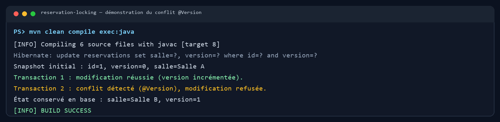
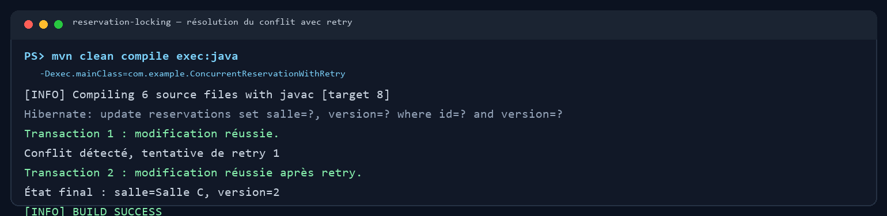

# TP 6 : Simuler un conflit de réservation concurrent et démontrer l'optimistic locking avec @Version

Ce dépôt reprend le TP Hibernate/JPA consacré à la réservation concurrente. Il montre comment `@Version` détecte une mise à jour fondée sur une version périmée, puis comment un retry peut recharger l'entité et réappliquer la modification demandée.

## Objectifs

- Créer un projet Maven Java avec JPA, Hibernate et H2.
- Modéliser une réservation avec un champ `@Version`.
- Charger deux snapshots détachés de la même réservation.
- Faire réussir la première mise à jour et faire refuser la seconde lorsqu'elle présente une ancienne version.
- Réessayer la seconde mise à jour après rechargement de l'état le plus récent.

## Prérequis

- JDK 8 ou supérieur (le TP est compilé avec Java 8 ; Java 17 fonctionne également).
- Maven 3.6 ou supérieur.

## Structure

```text
src/main/java/com/example/
├── ConcurrentReservationSimulator.java
├── ConcurrentReservationWithRetry.java
├── ReservationRetryHandler.java
├── model/Reservation.java
├── service/ReservationService.java
└── service/ReservationServiceImpl.java
src/main/resources/META-INF/persistence.xml
```

## Exécution du TP

À la racine du dépôt, lancer la démonstration du conflit :

```bash
mvn clean compile exec:java
```

Le programme crée la réservation, charge deux copies avec la même version, met à jour la première, puis tente la mise à jour avec la deuxième copie périmée. Hibernate émet une requête conditionnée par `id` et `version`; la seconde écriture ne peut pas écraser la première.

Pour observer la stratégie de retry :

```bash
mvn clean compile exec:java -Dexec.mainClass=com.example.ConcurrentReservationWithRetry
```

Le gestionnaire garde la modification demandée, recharge la réservation après le conflit, réapplique la valeur souhaitée sur la nouvelle version et relance l'opération. Le nombre de retries est limité à trois.

## Résultat observé

La première exécution affiche notamment :

```text
Snapshot initial : id=1, version=0, salle=Salle A
Transaction 1 : modification réussie (version incrémentée).
Transaction 2 : conflit détecté (@Version), modification refusée.
État conservé en base : salle=Salle B, version=1
```

Avec le gestionnaire de retry, la seconde demande est appliquée après rechargement et la version progresse encore.

## Capture de l'exécution

La capture ci-dessous montre la sortie réelle du terminal après l'exécution de la démonstration. Elle documente le succès de la première mise à jour, le conflit détecté pour le snapshot périmé et l'état final conservé en base.



La variante avec retry est illustrée séparément :



## Pourquoi `merge` est utilisé dans le service

Le code pédagogique présenté dans l'étape du service recharge l'entité dans un nouvel `EntityManager`, puis copie seulement ses champs métier. Dans ce cas, le snapshot périmé n'apporte pas son ancienne valeur de `version` à la mise à jour; le conflit attendu peut donc ne pas se produire. Cette implémentation transmet plutôt le snapshot détaché à `EntityManager.merge`, puis force le flush dans la transaction. JPA/Hibernate peut ainsi comparer son `@Version` à la version en base et refuser correctement la mise à jour obsolète.

La simulation charge les deux snapshots avant la première mise à jour. Elle reproduit de façon déterministe le cas où deux utilisateurs ont lu la même version, sans nécessiter de threads ou de verrouillage physique.

## Fichiers principaux

- `src/main/java/com/example/model/Reservation.java` : entité et champ `@Version`.
- `src/main/java/com/example/service/ReservationServiceImpl.java` : opérations JPA et contrôle de conflit.
- `src/main/java/com/example/ConcurrentReservationSimulator.java` : conflit sans retry.
- `src/main/java/com/example/ReservationRetryHandler.java` : politique de retry bornée.
- `src/main/java/com/example/ConcurrentReservationWithRetry.java` : démonstration de la résolution.

Le QCM du cours n'est pas inclus dans ce dépôt.
